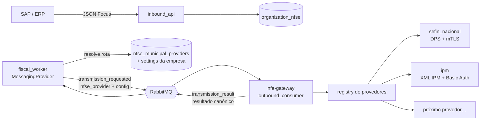

# NFS-e: provedores municipais plugáveis

## Motivação

Até aqui toda NFS-e de saída ia para a **SEFIN Nacional** (`nfe-gateway/src/nfe_gateway/nfse/`). Nem todo município funciona assim. Garuva/SC é conveniado ao padrão nacional, mas a emissão via API continua no sistema da prefeitura, o **Atende.Net da IPM**, com layout XML próprio, Basic Auth e sem chave de acesso de 50 dígitos. Outros municípios vão aparecer com outros sistemas (ABRASF de outro fornecedor, webservice municipal etc.).

O objetivo deste desenho é que **plugar um município novo** se resuma a:

1. escrever um *adapter* de provedor no `nfe-gateway` (se o sistema ainda não existir lá), e
2. inserir uma linha no catálogo `nfse_municipal_providers` apontando o município para esse provedor.

Tudo o que o cliente vê **não muda**: o contrato da API (espelho da Focus NFe), o payload SAP, os status, os webhooks, o DANFSe por download e o cancelamento continuam iguais para qualquer município.

## Princípios

- **Contrato canônico único.** O JSON que o cliente envia (`POST /v1/fiscal_documents/nfse`, formato Focus) é o modelo canônico. Cada provedor *traduz* esse modelo para o formato do município. Nenhum campo novo de API por município: o que for específico do município vem do **catálogo** (configuração) ou é derivado.
- **Resultado canônico único.** Todo provedor devolve o mesmo dicionário de resultado (`outcome`, `number`, `verification_code`, `access_key`, `protocol`, `cstat`, `x_motivo`, `pdf_url`…). O Go aplica a máquina de estados sem saber qual provedor respondeu.
- **Roteamento no Go, protocolo no Python.** O backend decide *para onde* (catálogo + override por empresa) e congela a decisão no documento. O gateway decide *como* (formato, transporte, assinatura, parsing).
- **Segredos continuam no backend.** Login/senha de webservice municipal ficam cifrados no Go (AES-256-GCM, `SECRETS_ENCRYPTION_KEY`) e são entregues sob demanda pelo `internal_api`, como já acontece com o PFX.
- **Decisão congelada por documento.** O provedor usado na emissão fica gravado em `organization_nfse.provider_code`/`provider_config`. Cancelamento e consulta usam o mesmo provedor, mesmo que o catálogo mude depois.

## Visão geral



## Catálogo e roteamento (backend Go)

### Tabelas (`migrations/058_nfse_municipal_providers.sql`)

| Tabela | Escopo | Para quê |
|---|---|---|
| `nfse_municipal_providers` | plataforma (global) | município IBGE → `provider_code` + `provider_config` (jsonb não-secreto: URL, série, formato de códigos, se exige assinatura…). Mantida pelo time da plataforma. |
| `organization_company_nfse_provider_settings` | tenant / empresa | credenciais do webservice municipal (usuário + senha cifrada), `config_overrides` (jsonb) e `force_route` (força o provedor para a empresa, independentemente do catálogo). Uma linha por empresa × provedor. |
| `organization_nfse.provider_code` / `provider_config` | documento | provedor e configuração efetivamente usados — snapshot gravado no handoff. |
| `organization_nfse.provider_pdf_url` / `provider_pdf_object_key` | documento | PDF oficial devolvido pelo provedor (quando não há XML nacional para renderizar o DANFSe). |

### Regra de resolução (`internal/nfseprovider.Service.Resolve`)

1. Existe `organization_company_nfse_provider_settings` com `force_route = true` para a empresa → usa esse provedor. A configuração base vem do catálogo do município se o provedor for o mesmo, senão `{}`; os `config_overrides` da empresa são aplicados por cima.
2. Senão, município do prestador (`organization_nfse.provider_municipality_code`, com fallback para os outros códigos) está em `nfse_municipal_providers` com `enabled = true` → usa o provedor do catálogo, com `config_overrides` da empresa para aquele provedor (se houver).
3. Senão → `sefin_nacional` (comportamento atual; nada muda para quem já emite).

### Descritores de provedor (Go)

O Go só precisa saber duas coisas de cada provedor, e isso fica numa tabela estática em `internal/nfseprovider/descriptors.go`:

| Campo | Uso |
|---|---|
| `IdentifiesBy` | `access_key` (SEFIN) ou `number` (IPM). O cancelamento exige chave ou número conforme o provedor. |
| `Credentials` | `none` ou `basic`. Se `basic`, a transmissão falha cedo com mensagem clara quando a empresa não tem credencial cadastrada. |

Todo o resto (formato, transporte, assinatura) é responsabilidade exclusiva do adapter Python.

### Eventos

`fiscal.document.transmission_requested.v1` (NFS-e) ganha:

```json
{
  "nfse_provider": "ipm",
  "nfse_provider_config": { "base_url": "...", "serie_nfse": "1", "item_lista_format": "nacional_6" },
  "municipality_code": "4205803"
}
```

`fiscal.document.cancel_requested.v1` (NFS-e) ganha `nfse_provider`, `nfse_provider_config`, `nfse_number`, `nfse_series` e `municipality_code`. `access_key` continua presente quando existe.

`fiscal.document.transmission_result.v1` ganha `provider_code`, `pdf_url` e `pdf_object_key`. Todos os campos são opcionais, e o Go os ignora quando vazios.

### Superfícies HTTP

| Rota | API | Uso |
|---|---|---|
| `POST /internal/v1/companies/{company_id}/nfse-provider-credentials` | internal_api | o gateway pede usuário/senha (corpo: `organization_id`, `provider_code`) — mesmo token de serviço e allowlist do signing-material |
| `GET /v1/nfse/municipal-providers` | control_plane | catálogo (somente leitura) para a tela de configuração |
| `GET/PUT/DELETE /v1/organizations/{org}/companies/{company}/nfse-provider-settings/{provider_code}` | control_plane | cadastro da credencial municipal da empresa; a senha nunca volta no GET |

## Framework de provedores (nfe-gateway)

```
nfe_gateway/nfse/providers/
├── base.py            # contrato: NfseProvider, EmitRequest, CancelRequest, ProviderCapabilities
├── registry.py        # code -> provider; default = sefin_nacional
├── payload.py         # leitura do JSON canônico (helpers comuns a todos os mappers)
├── municipios.py      # IBGE -> TOM/SIAFI (data/ibge_tom.json)
├── sefin_nacional.py  # adapter do fluxo que já existia (dps.py + sefin.py)
└── ipm/
    ├── __init__.py    # IpmProvider
    ├── mapper.py      # JSON canônico -> XML IPM (NTE 35/2021 + NTE 122/2025)
    ├── ibscbs.py      # bloco IBSCBS calculado (IPM exige valores, não calcula)
    ├── client.py      # POST multipart, Basic Auth, sessão PHPSESSID, 1 requisição por vez
    ├── retorno.py     # <retorno> -> resultado canônico
    └── sign.py        # XMLDSig opcional (<nfse id="nota">)
```

### Contrato

```python
class NfseProvider(Protocol):
    code: str
    def capabilities(self, config: dict) -> ProviderCapabilities: ...
    def emit(self, req: EmitRequest) -> dict: ...      # resultado canônico de transmissão
    def cancel(self, req: CancelRequest) -> dict: ...  # resultado canônico de evento
```

`ProviderCapabilities` diz ao worker o que buscar antes de chamar o adapter:

| Campo | Exemplo SEFIN | Exemplo IPM |
|---|---|---|
| `needs_certificate` | `True` (mTLS) | `config.assinatura` (só se o município exigir) |
| `credentials` | `none` | `basic` |
| `identifies_by` | `access_key` | `number` |
| `homologation` | `environment` (produção restrita) | `test_flag` (`<nfse_teste>1</nfse_teste>`) |

O `outbound_consumer` e o `event_consumer` não conhecem mais nenhum protocolo de NFS-e: buscam o provedor no registry, pedem certificado/credencial só se o provedor precisar, chamam `emit`/`cancel`, gravam `signed_xml`/`response_xml`/PDF no object storage e publicam o resultado.

### Resultado canônico

| Chave | Obrigatória | Observação |
|---|---|---|
| `outcome` | sim | `authorized`, `rejected`, `error`, `retry` (o Go reenfileira) |
| `number`, `verification_code` | quando autorizada | número da NFS-e e código de verificação/autenticidade |
| `access_key`, `protocol` | se o provedor tiver | chave de 50 dígitos (SEFIN); vazio na IPM |
| `cstat`, `x_motivo`, `error_code`, `error_message` | em rejeição | códigos do provedor prefixados (`ipm_00123`) quando não são da SEFIN |
| `signed_xml`, `response_xml` | recomendado | gravados como `provider_request` / `sefaz_response` |
| `pdf_url`, `pdf_bytes` | opcional | o worker grava `pdf_bytes` em `{payload}.provider_pdf.pdf` e publica `pdf_object_key` |
| `ibscbs` | opcional | IBS/CBS oficial devolvido pelo provedor |

### Homologação

- **SEFIN**: ambiente de produção restrita, como hoje.
- **IPM**: não existe ambiente de homologação. Em `homologation` o adapter envia o XML com `<nfse_teste>1</nfse_teste>`; a IPM valida e não emite número. Quando o XML é válido, o resultado é `authorized` com `error_code = homologacao_validada` e sem número de NFS-e, para o QAS devolver ok ao cliente. Rejeição de cadastro (ex.: 00042) continua `rejected`. `SEFAZ_FORCE_HOMOLOGACAO=true` (default) continua valendo para todos os provedores.

### Idempotência

Na IPM, a tag `<identificador>` impede reprocessamento: reenviar o mesmo identificador devolve a nota já gerada. O adapter usa `nexus-<document_id>-<hash do XML>`: um *retry* do mesmo conteúdo (timeout) recupera a nota já emitida, e um reenvio após correção (conteúdo diferente) gera nova tentativa.

## Provedor IPM (Atende.Net) — mapeamento

| JSON canônico | XML IPM | Regra |
|---|---|---|
| `data_emissao` | `nf/data_fato_gerador` | `dd/mm/aaaa` |
| `servico.valor_servicos` | `nf/valor_total`, `itens/lista/valor_tributavel` | vírgula decimal |
| `servico.desconto_incondicionado` | `itens/lista/valor_desconto_incondicional` | |
| `servico.desconto_condicionado` | `nf/valor_desconto` | só assinala, não altera a base |
| `servico.codigo_nbs` | `itens/lista/codigo_nbs` | obrigatório (9 dígitos) |
| `servico.valor_deducoes` | `itens/lista/valor_deducao` | |
| `servico.valor_ir/inss/csll` | `nf/valor_ir`, `valor_inss`, `valor_contribuicao_social` | retenções informativas |
| `situacao_tributaria_pis_cofins`, `base_calculo_pis_cofins`, `aliquota_pis`, `aliquota_cofins` | `nf/pis_cofins` (cst, base_calculo, aliquota_pis, aliquota_cofins) | PIS/COFINS próprio (NTE 122 v1.7) |
| `servico.valor_pis/valor_cofins` | `nf/valor_pis`, `nf/valor_cofins` | só quando `tipo_retencao_pis_cofins = 1` (retenção) |
| `informacoes_complementares` / `observacao` | `nf/observacao` | até 1000 |
| `prestador.cnpj`, `prestador.codigo_municipio` | `prestador/cpfcnpj`, `prestador/cidade` | IBGE → **TOM** (`data/ibge_tom.json`) |
| `tomador.cnpj/cpf/nif` | `tomador/tipo` J/F/E + `cpfcnpj`/`identificador` | |
| `tomador.endereco.*` | `tomador/logradouro`… `cidade` (TOM), `cep` | `endereco_informado` = S quando há endereço |
| `tomador.telefone` | `ddd_fone_comercial` + `fone_comercial` | |
| `servico.item_lista_servico` | `itens/lista/codigo_item_lista_servico` | `config.item_lista_format`: `lc116` (14.01 → 1401) ou `nacional_6` (14.01 → 140101). Garuva exige o desdobramento nacional: 1401 devolve IPM 00383. O 00042 é atividade fora do econômico |
| `servico.codigo_tributario_municipio` | `itens/lista/codigo_atividade` | |
| `servico.codigo_municipio` | `itens/lista/codigo_local_prestacao_servico` | IBGE → TOM |
| `natureza_operacao` / `iss_retido` | `situacao_tributaria`, `tributa_municipio_prestador` | `servico.situacao_tributaria` explícito tem prioridade; senão 3→6 ISE, 4→7 IMU, retido→2 TIST, demais→0 TI; natureza 2 → N |
| `servico.aliquota` | `aliquota_item_lista_servico` | fração ou pontos percentuais (mesma regra do `dps.py`) |
| `servico.valor_iss_retido` | `valor_issrf` | calculado (base × alíquota) se retido e não informado |
| `servico.discriminacao` | `itens/lista/descritivo` | até 1000 |
| `serie_rps`/`numero_rps` | `rps/*` | só com `config.enviar_rps = true` (o município precisa autorizar) |
| IBS/CBS (`ibs_cbs_situacao_tributaria`, `ibs_cbs_classificacao_tributaria`, `codigo_indicador_operacao`, `finalidade_emissao`, `consumidor_final`, `tipo_operacao`, `imovel`) | `nf/IBSCBS/cLocalidadeIncid` + `nfse/IBSCBS` (finNFSe, indFinal, cIndOp, tpOper, gRefNFSe, imovel, valores/trib/gIBSCBS) | NTE 122/2025 **v1.7**: o XML leva só a classificação; **a IPM calcula** e devolve `nf/IBSCBS` (valores + totCIBS) no retorno completo, repassado ao backend como `ibscbs`. Município de incidência: `servico.codigo_localidade_incidencia`, senão `config.localidade_incidencia`, senão derivado do cIndOp / domicílio do tomador. |

`provider_config` aceito pela IPM:

| Chave | Default | |
|---|---|---|
| `base_url` | — | obrigatório; formato do manual (NTE 35 §3.1): `https://ws-<cidade>.atende.net/?pg=rest&service=WNERestServiceNFSe` (Garuva: `ws-garuva`) |
| `serie_nfse` | `"1"` | série municipal da NFS-e |
| `item_lista_format` | `"lc116"` | `lc116` ou `nacional_6` |
| `assinatura` | `false` | `true` se o município exige XMLDSig (usa o A1 da empresa) |
| `enviar_rps` | `false` | |
| `ibscbs` | `true` | envia o bloco quando o payload tem CST/cClassTrib |
| `timeout_seconds` | `60` | |
| `file_field` | `"xml"` | nome do campo multipart (exemplo PHP do manual) |
| `localidade_incidencia` | `""` | `prestador`, `prestacao` ou `tomador` para fixar o cLocalidadeIncid |

## Cancelamento, consulta e DANFSe

- **Cancelamento**: `POST .../cancel` continua igual para o cliente. O Go lê o provedor congelado na nota; se `IdentifiesBy = number`, exige `nfse_number` em vez de `access_key`. A IPM cancela com `<nf><numero/><serie_nfse/><situacao>C</situacao><observacao/></nf>`.
- **DANFSe**: se a nota tem `provider_pdf_object_key`, o download devolve o PDF oficial do provedor; senão, continua renderizando a partir do XML nacional.
- **Consulta (GET do documento)**: além de `numero`/`codigo_verificacao`, passa a expor `url` (link oficial da NFS-e, campo que a Focus também devolve).

## Como plugar um município novo

1. **O sistema do município já tem adapter?** (ex.: outro município IPM). Basta inserir no catálogo:
   ```sql
   insert into nfse_municipal_providers (ibge_municipality_code, municipality_name, uf, provider_code, provider_config)
   values ('4202909', 'Brusque', 'SC', 'ipm', '{"base_url": "https://brusque.atende.net/atende.php?pg=rest&service=WNERestServiceNFSe&cidade=padrao"}');
   ```
   e cadastrar a credencial da empresa em `nfse-provider-settings/ipm`.
2. **Sistema novo?** Criar `nfe_gateway/nfse/providers/<codigo>/` com `mapper.py`, `client.py`, `retorno.py` e a classe do provedor, registrar no `registry.py`, adicionar o descritor em `internal/nfseprovider/descriptors.go` e os testes com fixtures do retorno real. O mapper **só lê o JSON canônico** (use `providers/payload.py`); qualquer particularidade do município vira chave de `provider_config`, nunca campo novo de API.
3. Validar em homologação (ou modo teste do provedor) antes de habilitar a linha do catálogo em produção.

## Pendências conhecidas

- Garuva: URL e autenticação conferidas no manual da prefeitura (NTE 35/2021 v2.8); IBS/CBS conforme NTE 122/2025 v1.7 (12/08/2026). Validar com `nfse_teste` o formato do código de serviço (6 dígitos, segundo a Focus) e a regra de município de incidência para o serviço da LS.
- Consulta de NFS-e por provedor (`query`) e substituição na IPM ficam para depois; o contrato já prevê `identifies_by` para isso.
- Tela de configuração no frontend (catálogo + credenciais da empresa).
